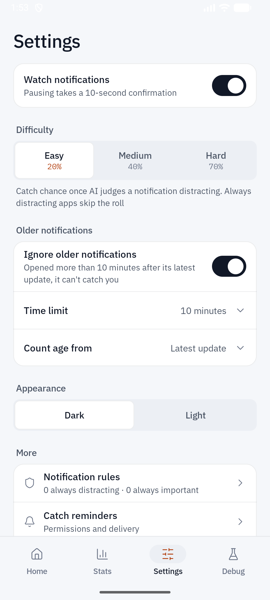
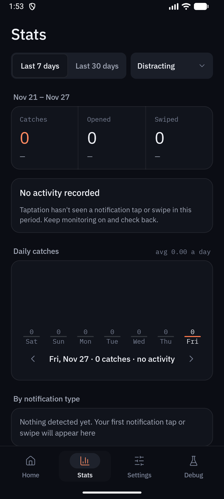
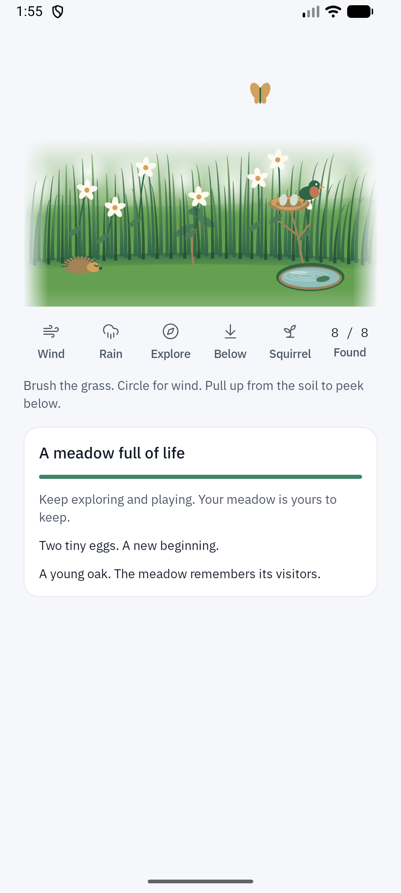

# Taptation UI design guide

Use this guide for every new screen, component, dialog, chart and visual change. The goal is
to extend the existing app with consistent, finished UI, even when the task prompt only says
"add this feature." Keep these defaults unless the user explicitly requests a different design.
Do not add eyebrow labels, uppercase section slogans or decorative subtitles above page headings. Use functional titles.
This guide governs presentation; [revised catch flow](revised-catch-flow.md) governs behavior.

## 1. Start here: the minimum recipe

1. Read the nearest existing screen and the shared components listed below.
2. Identify the one question the screen answers and its most important action or number.
3. Use `TaptationTheme`, `TabScreen` and `SectionCard`. Build from existing patterns.
4. Use theme colors and typography roles. Apply the spacing and shape values in this guide.
5. Connect real state and actions, including loading, empty, error and disabled states.
6. Render on Android. Inspect light/dark mode, a narrow phone and enlarged text. Fix visible
   problems before reporting completion. If rendering is unavailable, say what remains unverified.

Do not replace working features with attractive placeholders. Do not create a separate theme
or duplicate a shared component to make one screen look different.

## 2. Visual references

These are real Android renders of the current design (Pixel-size emulator, API 37), produced by the
instrumented tests (`MockupScreensTest`, `AppearanceTest`, `FishingCatchUiTest`, `MeadowWorldTest`,
`CaughtOverlayTest`), which save them under the app's external files `ui-previews` folder. They are
visual baselines, not pixel specs or real data. Dark is the default appearance.

| Home | Settings | Statistics |
|---|---|---|
|  |  |  |

| Caught choice | Notification rules | Meadow |
|---|---|---|
|  |  |  |

The direction is **Lake & bobber** (chosen from `docs/ui-reference/unslop-mockups.html`):
- **Character:** alert, playful, precise.
- **World:** the pond from the caught scene: ink-dark water, a red-orange bobber on the surface.
- **Quiet chrome, two rich moments:** surfaces, text, buttons and switches use one neutral ink ramp.
  The colour lives in the health-driven meadow on Home and the fishing scene on the caught dialog.
- **One accent, the bobber orange:** catches, damage, the selected chart day, the selected tab icon,
  the difficulty percentage. Nothing else.
- **Signature:** the bobber (`ui/common/Components.kt` `Bobber`). It floats while Taptation is
  watching notifications. Don't reuse it as decoration elsewhere.

For the meadow, use `grass-screen-mockup.html` as the geometry and motion reference:
78 tall curved blades on one fading mound, saturated blade colors, coherent wind and
damped springs for brushing. The grass keeps its own greens; don't tint it with the ink ramp.
Health changes density/height; touch changes appearance only.
The [living meadow](living-meadow.md) adds earned flowers/visitors, permanent discoveries and
landmarks, an underground view, and an isolated Debug preview. Keep progression in `logic/meadow`;
do not copy the mockup's time-skip or manual-unlock controls into the public Home screen.

## 3. Tokens: use roles in code

The implementation lives in `app/src/main/java/com/codejam/taptation/ui/theme/`.
`Color.kt`, `Theme.kt` and `Type.kt` are the source for exact values. Change shared tokens
there when an intentional app-wide design change is requested. Avoid hard-coded colors in screens.

| Purpose / role | Light | Dark |
|---|---|---|
| Page / `background` | `#F5F7FA` | `#0B0D14` |
| Cards, groups / `surfaceContainerLowest` | `#FFFFFF` | `#11141C` |
| Raised: segmented track, inputs, selected tab / `Taptation.palette.raised` | `#ECEFF4` | `#1A1E28` |
| Main text / `onSurface` | `#111827` | `#EEF0F5` |
| Supporting text / `onSurfaceVariant` | `#4B5565` | `#A3A9B8` |
| Muted text, meta, icons / `Taptation.palette.muted` | `#6B7487` | `#7A8296` |
| Hairlines / `outlineVariant` | ink at 8% | ink at 8% |
| Primary button, switch, radio / `primary` | ink `#111827` | off-white `#EEF0F5` |
| Bobber accent / `tertiary`, `Taptation.palette.catch` | `#C2410C` | `#FF7A4D` |
| Accent as text / `Taptation.palette.catchText` | `#B23C0B` | `#FF8A61` |
| Health bars / `Taptation.palette.health` | `#3D8566` | `#68A985` |
| Errors / `error` | `#DC2626` | `#F07174` |

- `primary` is deliberately neutral (the ink). Buttons, switches and selection don't carry colour.
- Use the bobber orange only for what a catch costs or marks. Health is green, like the grass.
- `tertiaryContainer` is the notice surface for setup and connection problems.
- Pair backgrounds with their content colors. For custom cards set `contentColor = MaterialTheme.colorScheme.onSurface`.
- Preserve the stable palette. Wallpaper-derived dynamic colors must not replace these colors.
- Dark is the app default. Settings → Appearance offers Dark/Light; the saved choice also governs
  caught overlays and system-bar contrast. Do not fall back to the phone theme for individual screens.
- The native caught overlay (`ui/overlay/CatchOverlay.kt`) reads the same constants from `Color.kt`;
  keep it in step with the Compose dialog.

Type is **IBM Plex Sans** for everything and **IBM Plex Mono** for times, counts, percentages and
other meta (`MetaText`). Both are bundled in `res/font` (SIL OFL, `docs/licenses/IBM-Plex-OFL.txt`).
Weights are 400 and 500, 600 at most. Hierarchy comes from size and colour, not weight.

| Text purpose | Typography role | Size / line height |
|---|---|---|
| Health figure on Home | `displayMedium` | 52sp / 56sp, regular |
| Caught dialog heading | `displaySmall` | 34sp / 40sp, medium |
| One page heading | `headlineLarge` | 28sp / 34sp, medium |
| Large stat figure | `headlineMedium` | 30sp / 36sp, regular |
| Card heading | `titleMedium` | 16sp / 22sp, medium |
| Row heading | `titleSmall` | 15sp / 20sp, medium |
| Explanation | `bodyMedium` | 14sp / 20sp |
| Caption / supporting text | `bodySmall` | 13sp / 18sp |
| Buttons, section labels | `labelLarge` | 14sp / 20sp, medium |
| Tab labels | `labelSmall` | 12sp / 16sp, medium |
| Meta: times, counts, axis labels | `MetaText` | Plex Mono 12sp / 16sp |

Use short sentence-case labels without trailing periods; only multi-sentence paragraphs keep them.
No exclamation marks. Say "distracting", never "bait", in product text: the rules are Always important,
Let us decide and Always distracting (`AppRule.AlwaysBait` in code; `AppRule.label()` in
`ui/common/AppRuleRow.kt`). Do not add eyebrow text above headings. Allow text to wrap before shrinking it.

Icons are Lucide line icons (ISC license) as vector drawables in `res/drawable` (`ic_*`), 1.5 stroke,
drawn with `LineIcon` at 18dp (20dp in the tab bar), tinted with a text role. No emoji and no text
glyphs (`›`, `←`, `✕`, `●`) as icons. Add a new icon by copying its Lucide paths into a new drawable.

## 4. Layout and components

| Element | Default |
|---|---|
| Page content width | Centered, maximum 560dp |
| Page padding | 20dp horizontally, 20dp top, inside system/navigation insets |
| Gap between items | 16dp; a section label sits 8dp above its group |
| Spacing | Multiples of 4dp only |
| Card / list group | 16dp corners, 1dp `outlineVariant` hairline, no shadow, 16dp padding |
| List row (`GroupRow`) | At least 56dp tall, 16dp side padding, hairline between rows |
| Controls (segmented, inputs) | 10dp corners; segmented options 8dp inside a 2dp track |
| Buttons | At least 48dp tall, 12dp corners (`ButtonShape`) |
| Caught dialog | 24dp corners, 20dp side padding, two stacked 48dp-minimum destinations |
| Bottom tab | Icon in a 56×28dp raised indicator when selected; single-line 12sp label |

Use whitespace to separate ideas. A new setting belongs in the closest existing section.
Move a complex group to a focused settings section instead of making the main page an endless form.
Do not put a card around every text line or nest several card borders around the same content.

Existing building blocks, relative to `app/src/main/java/com/codejam/taptation/`:

| File / component | Reuse for |
|---|---|
| `ui/common/Layout.kt`: `TabScreen` | Page heading, width, scroll and navigation insets |
| `ui/common/Layout.kt`: `SectionLabel`, `ListGroup`, `GroupRow`, `RowDivider` | Settings-style lists: a label, then rows on one card |
| `ui/common/Layout.kt`: `SectionCard`, `LabelValue`, `LineIcon` | Blocks of text or controls, label/value rows, icons |
| `ui/common/Components.kt`: `SegmentedChoice`, `Bobber`, `BackLink` | Exclusive choices (optional mono caption), the monitoring signature, back navigation |
| `ui/TaptationApp.kt` | Existing tab navigation and saved tab state |
| `ui/settings/ActivationControls.kt` | Activation switch and confirmation friction |
| `ui/settings/SettingsScreen.kt` | Grouped settings rows, difficulty segmented control, focused sections |
| `ui/stats/StatsScreen.kt` | Figure strip, scope menu, daily chart, ranked list with thin bars |
| `ui/common/AppRuleRow.kt`: `AppRuleListRow`, `AppRuleSheet` | Apps grouped by rule; the rule is changed in a bottom sheet |
| `ui/common/CatchChoiceDialog.kt` | Foreground caught presentation |
| `service/CatchFeedback.kt` | Native overlay; keep its appearance aligned with the Compose dialog |
| `ui/home/GrassMeadow.kt` | Interactive meadow driven by health |

Example page structure (imports omitted; callbacks and data come from the actual feature):

```kotlin
@Composable
fun ExampleScreen(padding: PaddingValues, safeAppCount: Int, onChooseApps: () -> Unit) {
    TabScreen(padding, title = "Notification rules") {
        item {
            SectionCard("Always-safe apps", "Every notification from these apps bypasses catches.") {
                LabelValue("Protected apps", safeAppCount.toString())
                Button(onClick = onChooseApps) { Text("Choose apps") }
            }
        }
    }
}
```

## 5. Screen and interaction recipes

- **Home:** functional Home heading, the bobber status row, the health figure, then the meadow driven by
  health, its toys as icon buttons, then cost/recovery figures and grouped lists. Setup comes first when
  needed; touch bends grass without changing health.
- **Stats:** period control and scope menu on one row, one figure strip (only catches take the accent),
  the daily chart (neutral bars, accent on the selected day, mono labels), then the ranked type list.
  Show units and denominators close to values.
  A missing denominator is a dash. Empty history gets an explanation, never fabricated trends.
- **Settings:** activation row, difficulty segmented control, older-notification rows, appearance, then
  links to focused sections.
  Opening a section starts at its top. Provide an obvious Back action and Android Back support.
- **Caught:** "Caught lacking" heading, short explanation, the fishing scene, health with the lost
  slice, then full-width primary "Go to Taptation" and raised secondary "Continue to <app>" with its
  extra cost in mono. Only these two destinations; Back or tapping outside postpones the choice. See the
  [fishing revision](caught-fishing-scenes.md). Keep both destinations enabled during animation and
  keep land-based visitors on the bank.
- **Lists/forms:** clear row labels, supporting text below, actions aligned consistently.
  Label every field. Explain why an action is disabled when the reason is not obvious.
- **Debug:** use the same visual foundation, with denser technical information where useful.
  Keep test controls, raw metadata and probability overrides out of release product screens.

A screen should have one visually dominant next action. Toggles and selected difficulty tiles
may still use the primary color. Secondary actions use outlined or text buttons. Write action
labels as specific verbs: "Choose apps", "Try again", "Keep active".

Loading, empty, error and success states must be distinct. Loading must not flash fake zeros
as if they were saved results. Errors should offer an applicable recovery action. Use plain,
brief, nonjudgmental copy; keep package names and implementation details in supporting/debug UI.

## 6. Guardrails against visual regressions

- Do not add new accent colors, purple/blue defaults, glass effects, gradients on surfaces, glows,
  coloured shadows, emoji or a second icon family. The bobber orange stays rare.
- Do not put a card around every item. Group related rows on one card with hairlines.
- Do not hard-code content heights for text, forms or lists. Use minimum heights and scrolling.
- Do not use tiny text to force everything onto one screen. Important explanations must remain legible.
- Reserve the actual scroll viewport above the bottom bar. Bottom content padding alone does
  not stop a focused/scrolled control from sitting behind an overlapping bar.
- Do not split a tab label over several lines.
- Check long app names, category names, VIP names, translated-length labels and large numbers.
- Keep touch targets at least 48dp, label icon-only actions, expose selected/disabled states
  to accessibility services and never use color as the only indicator.
- Use the theme's foreground/background pairs; check contrast on custom pairs. Do not reduce
  the opacity of essential text simply to make a screen look softer.
- Preserve state, privacy rules, classification, cooldowns, debug access and actual navigation.
  A styling request does not authorize inventing behavior, fake data or non-working buttons.

## 7. Definition of done

- [ ] The nearest existing screen and shared components were reused where appropriate.
- [ ] Palette, typography, spacing and shapes follow this guide; no accidental Material defaults.
- [ ] The first visible screenful has a clear hierarchy and meaningful content.
- [ ] All visible actions work; loading/empty/error/disabled cases are accounted for.
- [ ] Text, controls and charts fit a 360dp-wide phone with at least 115% text size.
- [ ] Light and dark themes are inspected, including dialogs, selected controls and system insets.
- [ ] Content scrolls above navigation; keyboard/focus does not hide the active input or action.
- [ ] A screenshot of every changed screen/state was inspected against the reference family.
- [ ] Relevant builds/checks pass. Behavior changes have appropriate tests; cosmetic changes
      do not need tests that merely repeat color or padding constants.
- [ ] The final report says what changed, what was actually checked and any remaining limits.

Use `MockupScreensTest` for existing navigation and screenshot coverage. Build with
`./gradlew assembleDebug`; run device tests with `./gradlew connectedDebugAndroidTest`
when an Android test device is available. On Windows use `.\gradlew.bat`.
Never claim visual verification from compilation alone. If a deliberate design change makes
a reference outdated, update the guide/reference with the implementation and explain why.

## 8. Copy-and-paste prompt for a future AI

```text
Implement [FEATURE] in this repository.

First read AGENTS.md, CLAUDE.md, docs/UI_DESIGN_GUIDE.md and the closest existing screen.
Follow the design guide and its screenshots. Reuse TaptationTheme, TabScreen, SectionCard
and existing patterns. Use semantic theme colors, established typography and spacing.
Keep the Lake & bobber look (neutral ink ramp, one bobber-orange accent, IBM Plex, Lucide line icons)
and support dark mode, narrow screens and larger text.

Wire real data and actions. Handle loading, empty, error and disabled states. Preserve the
current behavior and debug tools. Use health to drive the meadow; touch must not change it.
Do not add placeholders, invented statistics, new visual styles or unrelated dependencies.

Render and inspect every changed screen. Check navigation, scrolling, keyboard behavior and
light/dark mode. Fix clipping, overflow and inconsistent hierarchy. Run relevant checks and
report the result honestly; say explicitly if device rendering was unavailable.
```

The [native overlay reference](design-reference/caught-native.png) shows the same caught layout over another Android screen.
