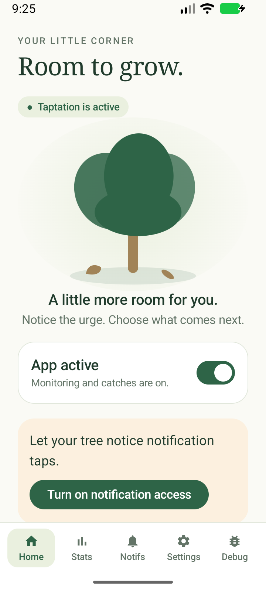
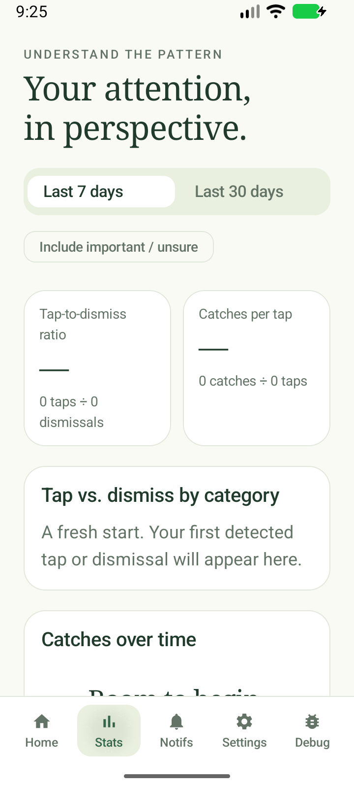
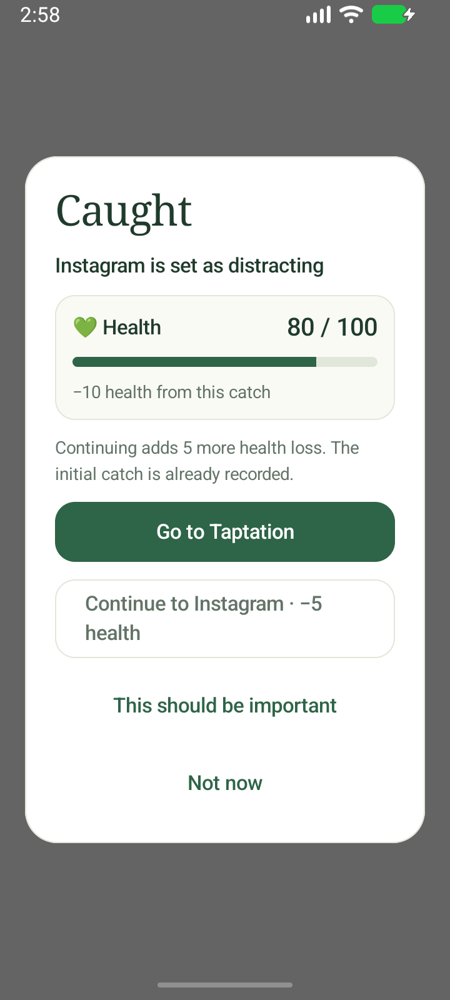
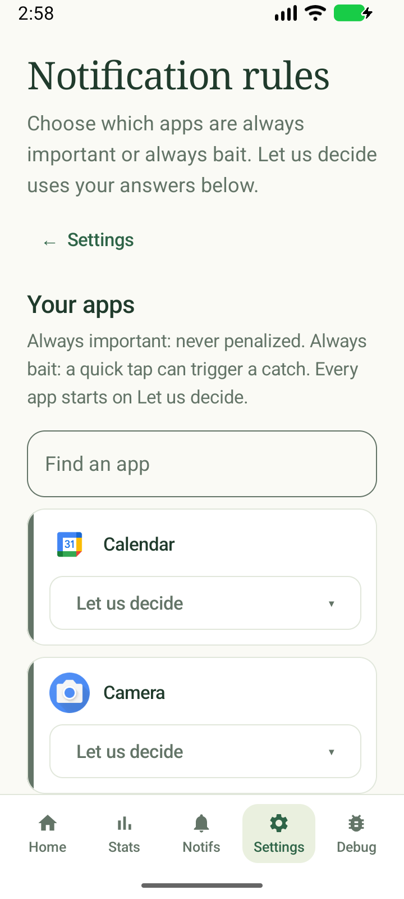
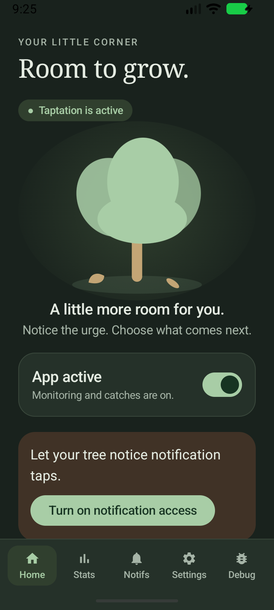

# Taptation UI design guide

Use this guide for every new screen, component, dialog, chart and visual change. The goal is
to extend the existing app with consistent, finished UI, even when the task prompt only says
"add this feature." Keep these defaults unless the user explicitly requests a different design.
Do not add eyebrow labels, uppercase section slogans or decorative subtitles above page headings. Use functional titles.
This guide governs presentation; [revised catch flow](revised-catch-flow.md) governs behavior.

## 1. Start here: the minimum recipe

1. Read the nearest existing screen and the shared components listed below.
2. Identify the one question the screen answers and its most important action or number.
3. Use `TaptationTheme`, `TabScreen` and `SectionCard`. Build from existing patterns.
4. Use theme colors and typography roles. Apply the spacing and shape values in this guide.
5. Connect real state and actions, including loading, empty, error and disabled states.
6. Render on Android. Inspect light/dark mode, a narrow phone and enlarged text. Fix visible
   problems before reporting completion. If rendering is unavailable, say what remains unverified.

Do not replace working features with attractive placeholders. Do not create a separate theme
or duplicate a shared component to make one screen look different.

## 2. Visual references

These are real Android renders of the implemented design, captured at 360dp width with 115%
text size. They are visual baselines, not pixel-perfect specifications or sample product data.
Below-the-fold content remains scrollable. Home references include actual Android light/dark system modes.

| Home | Settings | Statistics |
|---|---|---|
|  |  |  |

| Caught choice | Notification rules | Dark theme |
|---|---|---|
|  |  |  |

The character is calm, botanical and spacious: cream background, forest-green emphasis,
serif page headings, simple sans-serif controls, white rounded cards and subtle borders.

For the meadow, use `grass-screen-mockup.html` as the geometry and motion reference:
78 tall curved blades on one fading mound, saturated blade colors, coherent wind and
damped springs for brushing. Do not blend grass with pale card colors or replace its
motion with rigid offsets. Health changes density/height; touch changes appearance only.

## 3. Tokens: use roles in code

The implementation lives in `app/src/main/java/com/codejam/taptation/ui/theme/`.
`Theme.kt`, `Color.kt` and `Type.kt` are the source for exact values. Change shared tokens
there when an intentional app-wide design change is requested. Avoid hard-coded colors in screens.

| Purpose / Material color role | Light | Dark |
|---|---|---|
| Page / `background` | Cream `#FAFAF5` | Night `#19221D` |
| Cards / `surfaceContainerLowest` | White `#FFFFFF` | `#253129` |
| Main text / `onSurface` | Ink `#203B2C` | `#E5ECE2` |
| Supporting text / `onSurfaceVariant` | `#637467` | `#A6B4A7` |
| Actions / `primary` | Forest `#2E6447` | `#A8CDA6` |
| Text on actions / `onPrimary` | White | `#173422` |
| Selected background / `primaryContainer` | Sage `#EAF0DF` | `#303F2E` |
| Borders / `outlineVariant` | `#E1E7DB` | `#39473B` |

- Use `primary` for an action, selected state or meaningful chart value. Keep most surfaces neutral.
- Use `tertiaryContainer` for a gentle setup notice. Use `error` for actual errors or destructive actions.
- Pair backgrounds with their corresponding content colors. For custom white/dark cards,
  explicitly set `contentColor = MaterialTheme.colorScheme.onSurface`; color-role aliases
  can otherwise make the heading inherit muted text.
- Preserve the stable palette. Wallpaper-derived dynamic colors must not replace these colors.
- Every custom surface must work in dark mode. Never put a hard-coded white panel behind theme text.

| Text purpose | Typography role | Size / line height |
|---|---|---|
| One page heading | `headlineLarge` | Serif, normal, 34sp / 40sp |
| Large metric | `headlineMedium` | Serif, normal, 30sp / 36sp |
| Smaller metric / empty-state heading | `headlineSmall` | Serif, normal, 26sp / 32sp |
| Card heading | `titleMedium` | Sans, medium, 18sp / 25sp |
| Row heading | `titleSmall` | Sans, medium, 14sp / 21sp |
| Explanation | `bodyMedium` | Sans, normal, 14sp / 21sp |
| Caption / supporting metadata | `bodySmall` | Sans, normal, 12sp / 18sp |
| Buttons | `labelLarge` | Sans, medium, 14sp / 20sp |

Use one serif page heading. Keep card headings and controls sans-serif. Use short sentence-case
labels. Do not add eyebrow text above headings. Allow text to wrap before shrinking it.

## 4. Layout and components

| Element | Default |
|---|---|
| Page content width | Centered, maximum 560dp |
| Page padding | 24dp horizontally and vertically, inside system/navigation insets |
| Gap between sections | 20dp |
| Card | 20dp corners, 1dp `outlineVariant` border, no decorative shadow |
| Card padding / internal gap | 18dp / 12dp |
| Related text or controls | 4–8dp for tight relationships; 12–16dp for groups |
| Main button | At least 48dp tall; 16dp corners for prominent full-width actions |
| Selection tile | 16dp corners; selected `primary` with `onPrimary` text |
| Caught dialog | 26dp corners, 24dp padding, vertically stacked 48dp-minimum actions |
| Bottom tab | 14dp selected background corners; single-line label; at least 48dp touch target |

Use whitespace to separate ideas. A new setting belongs in the closest existing section.
Move a complex group to a focused settings section instead of making the main page an endless form.
Do not put a card around every text line or nest several card borders around the same content.

Existing building blocks, relative to `app/src/main/java/com/codejam/taptation/`:

| File / component | Reuse for |
|---|---|
| `ui/common/Layout.kt`: `TabScreen` | Page heading, width, scroll and navigation insets |
| `ui/common/Layout.kt`: `SectionCard`, `LabelValue` | Groups of controls and label/value rows |
| `ui/TaptationApp.kt` | Existing tab navigation and saved tab state |
| `ui/settings/ActivationControls.kt` | Activation switch and confirmation friction |
| `ui/settings/SettingsScreen.kt` | Difficulty tiles, settings links and focused sections |
| `ui/stats/StatsScreen.kt` | Metric cards, filters, real category and daily charts |
| `ui/common/CatchChoiceDialog.kt` | Foreground caught presentation |
| `service/CatchFeedback.kt` | Native overlay; keep its appearance aligned with the Compose dialog |
| `ui/home/GrassMeadow.kt` | Interactive meadow driven by health |

Example page structure (imports omitted; callbacks and data come from the actual feature):

```kotlin
@Composable
fun ExampleScreen(padding: PaddingValues, safeAppCount: Int, onChooseApps: () -> Unit) {
    TabScreen(padding, title = "Notification rules") {
        item {
            SectionCard("Always-safe apps", "Every notification from these apps bypasses catches.") {
                LabelValue("Protected apps", safeAppCount.toString())
                Button(onClick = onChooseApps) { Text("Choose apps") }
            }
        }
    }
}
```

## 5. Screen and interaction recipes

- **Home:** functional Home heading, actual monitoring status, then a seamless meadow driven by health.
  Use a heart beside Health. Setup comes first when needed; touch bends grass without changing health.
- **Stats:** period selector, a small set of prominent metrics, then supporting charts.
  Keep adjacent metric cards equal height. Show units and denominators close to values.
  A missing denominator is a dash. Empty history gets an explanation, never fabricated trends.
- **Settings:** activation, fixed difficulty tiles, freshness summary, then focused rule sections.
  Opening a section starts at its top. Provide an obvious Back action and Android Back support.
- **Caught:** small branded badge, one serif heading, short explanation, full-width primary
  "Go to Taptation" and secondary "Go to original app". Keep the two destinations distinct.
- **Lists/forms:** clear row labels, supporting text below, actions aligned consistently.
  Label every field. Explain why an action is disabled when the reason is not obvious.
- **Debug:** use the same visual foundation, with denser technical information where useful.
  Keep test controls, raw metadata and probability overrides out of release product screens.

A screen should have one visually dominant next action. Toggles and selected difficulty tiles
may still use the primary color. Secondary actions use outlined or text buttons. Write action
labels as specific verbs: "Choose apps", "Try again", "Keep active".

Loading, empty, error and success states must be distinct. Loading must not flash fake zeros
as if they were saved results. Errors should offer an applicable recovery action. Use plain,
brief, nonjudgmental copy; keep package names and implementation details in supporting/debug UI.

## 6. Guardrails against visual regressions

- Do not add purple/blue defaults, arbitrary accent colors, glass effects, gradients on cards,
  heavy shadows, emoji navigation or a new icon family. The tree's subtle halo is an existing exception.
- Do not hard-code content heights for text, forms or lists. Use minimum heights and scrolling.
- Do not use tiny text to force everything onto one screen. Important explanations must remain legible.
- Reserve the actual scroll viewport above the bottom bar. Bottom content padding alone does
  not stop a focused/scrolled control from sitting behind an overlapping bar.
- Narrow debug navigation may use "Notifs". Do not split a tab label over several lines.
- Check long app names, category names, VIP names, translated-length labels and large numbers.
- Keep touch targets at least 48dp, label icon-only actions, expose selected/disabled states
  to accessibility services and never use color as the only indicator.
- Use the theme's foreground/background pairs; check contrast on custom pairs. Do not reduce
  the opacity of essential text simply to make a screen look softer.
- Preserve state, privacy rules, classification, cooldowns, debug access and actual navigation.
  A styling request does not authorize inventing behavior, fake data or non-working buttons.

## 7. Definition of done

- [ ] The nearest existing screen and shared components were reused where appropriate.
- [ ] Palette, typography, spacing and shapes follow this guide; no accidental Material defaults.
- [ ] The first visible screenful has a clear hierarchy and meaningful content.
- [ ] All visible actions work; loading/empty/error/disabled cases are accounted for.
- [ ] Text, controls and charts fit a 360dp-wide phone with at least 115% text size.
- [ ] Light and dark themes are inspected, including dialogs, selected controls and system insets.
- [ ] Content scrolls above navigation; keyboard/focus does not hide the active input or action.
- [ ] A screenshot of every changed screen/state was inspected against the reference family.
- [ ] Relevant builds/checks pass. Behavior changes have appropriate tests; cosmetic changes
      do not need tests that merely repeat color or padding constants.
- [ ] The final report says what changed, what was actually checked and any remaining limits.

Use `MockupScreensTest` for existing navigation and screenshot coverage. Build with
`./gradlew assembleDebug`; run device tests with `./gradlew connectedDebugAndroidTest`
when an Android test device is available. On Windows use `.\gradlew.bat`.
Never claim visual verification from compilation alone. If a deliberate design change makes
a reference outdated, update the guide/reference with the implementation and explain why.

## 8. Copy-and-paste prompt for a future AI

```text
Implement [FEATURE] in this repository.

First read AGENTS.md, CLAUDE.md, docs/UI_DESIGN_GUIDE.md and the closest existing screen.
Follow the design guide and its screenshots. Reuse TaptationTheme, TabScreen, SectionCard
and existing patterns. Use semantic theme colors, established typography and spacing.
Keep the cream/forest/sage appearance and support dark mode, narrow screens and larger text.

Wire real data and actions. Handle loading, empty, error and disabled states. Preserve the
current behavior and debug tools. Use health to drive the meadow; touch must not change it.
Do not add placeholders, invented statistics, new visual styles or unrelated dependencies.

Render and inspect every changed screen. Check navigation, scrolling, keyboard behavior and
light/dark mode. Fix clipping, overflow and inconsistent hierarchy. Run relevant checks and
report the result honestly; say explicitly if device rendering was unavailable.
```

The [native overlay reference](design-reference/caught-native.png) shows the same caught layout over another Android screen.
