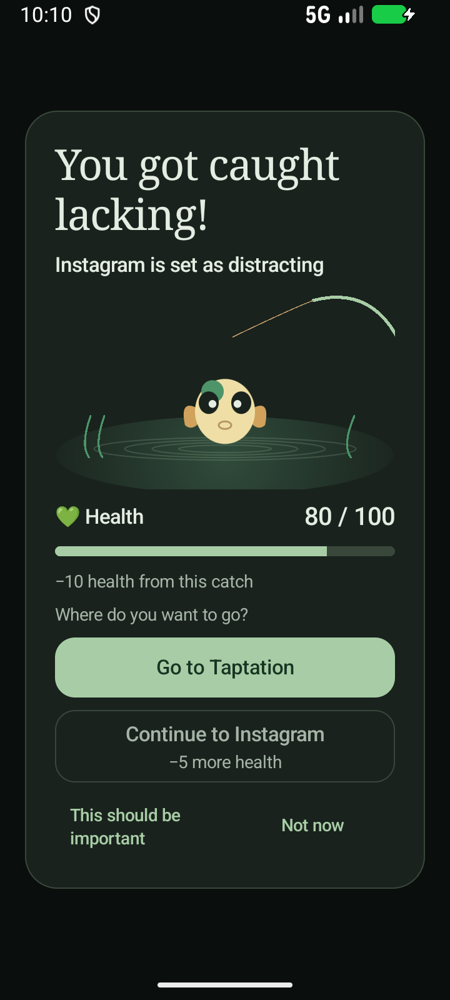
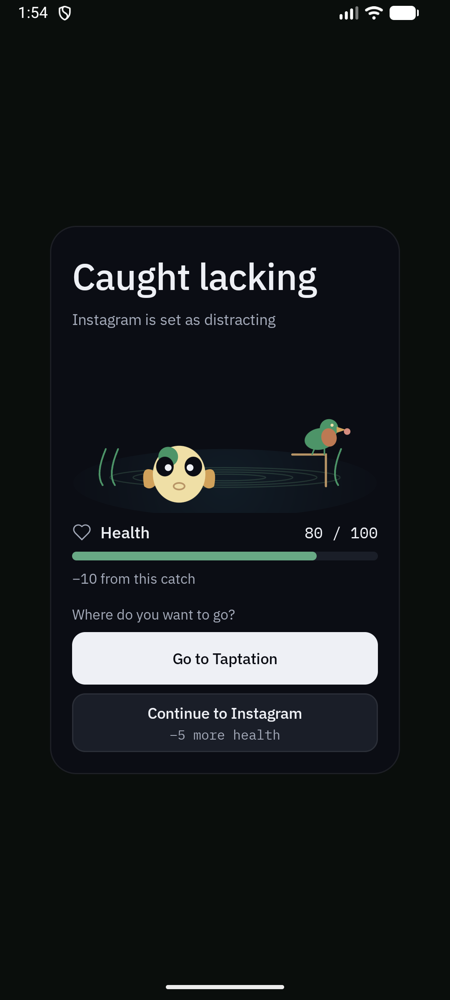
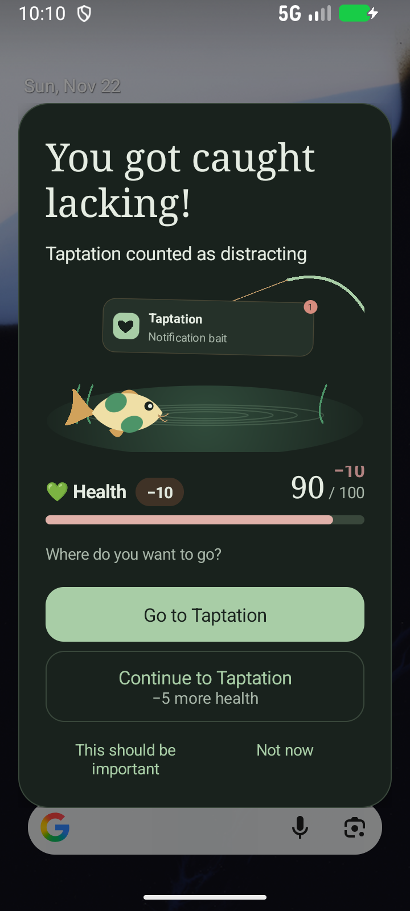

# Caught fishing scenes

Both caught surfaces now use the **You got caught lacking!** headline and the fishing mockup:
the fish takes a miniature notification card underwater, then resurfaces facing the user. The
card contains only the app label and generic bait text, never notification title/text.

## Shared rendering and earned cameos

- `ui/caught/FishingSceneView` is the same native animation view in both the Compose dialog
  (`FishingCatchScene` / `AndroidView`) and `TYPE_APPLICATION_OVERLAY` (`CatchOverlay`).
- Fish is always available. `MeadowState.catchCameos` additionally exposes the earned robin,
  squirrel and discovered hedgehog.
- `MeadowRepository.sceneFor(catchId)` caches a bounded, deterministic selection for the catch.
  Switching surfaces or unlocking a visitor cannot change that catch's cached scene.
- Robin steals the bait. Squirrel buries the card on a grassy bank. Hedgehog sleeps on the bank
  while the fish splashes. Land animals are not drawn sitting in the pond.
- `TaptationApplication` supplies the native overlay's scene resolver and saved appearance.
  The in-app dialog requests the same cached scene for the same catch id.

## Behavior remains owned by the caught flow

- The scene never calls game actions. It does not apply damage, roll again, grant discoveries,
  or launch another app. Tapping it is cosmetic.
- Both destination buttons are enabled immediately, including during the intro. The existing
  `CatchActions` / `feedback.actionsFor` still own choosing, correction and postponing.
- The existing health loss bar interpolates green → red → green; compact layout replaces its
  extra card border inside the dialog. Continuing shows the backend's actual extra cost.
- `prompt.animate` controls whether to play the intro or show its final pose. Rebinding the
  same view/catch does not restart an already-running intro. Native animator preferences are
  respected; frame callbacks stop when hidden, detached, or out of the visible scroll area.
- Dark/Light follows the saved app appearance on both surfaces.
- Long content and enlarged text remain scrollable. Only the two destinations are offered; the correction and Not now buttons were removed.

## Debug and verification

Debug → Preview caught animations opens isolated fixtures, with visitor and light/dark choices.
Neither preview destinations nor preview correction write real game/appearance/meadow state.

Unit checks cover earned cameo eligibility; repository tests cover stable selection across unlocks.
Device tests cover the real native overlay (including zero health and one continuing penalty),
foreground callbacks, all four scenes in both themes, static postponed prompts and debug isolation.

## Android references

Actual 360dp/115% renders. Foreground images are isolated preview fixtures; the native image
comes from the real overlay/catch/continuing-penalty test with an isolated game store.

| In-app fish | Earned robin cameo | Native overlay |
|---|---|---|
|  |  |  |
