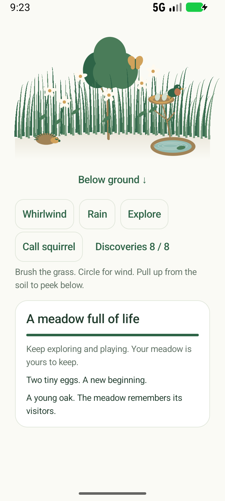
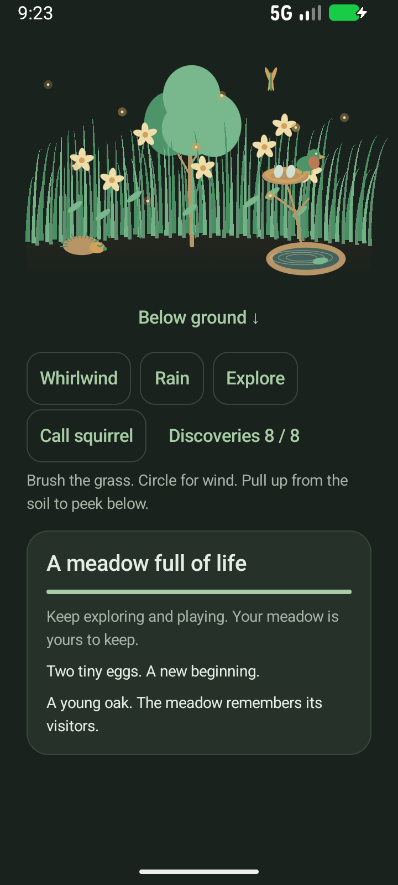
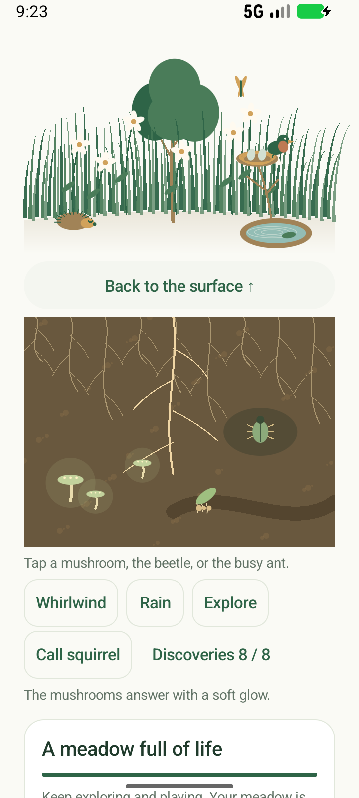

# Living meadow

Implemented from the interactive living-meadow mockup. The [fishing/caught revision](caught-fishing-scenes.md)
uses earned meadow visitors for cosmetic caught cameos through the same backend scene resolver.

## Ownership

- `logic/meadow/MeadowState`: earned growth, discoveries and derived story milestones.
- `logic/meadow/MeadowProgression`: pure accounting from the existing game's health history.
- `logic/meadow/MeadowRepository`: application-scoped observer, minute refresh and separate
  `meadow_world_v1` preferences. Publishes state only after a successful save.
- `TaptationApplication.meadow`: composition-root wiring. Existing game, catch, recovery,
  classification and statistics behavior are unchanged.
- `ui/home/LivingMeadow`: renders state and sends discovery intents. Brushes, circles, showers,
  creature reactions, seeds and underground interactions are ephemeral presentation effects.
- `ui/home/MeadowPainter`: reusable native drawing primitives; `MeadowMotion`: fixed-step spring
  simulation. Rendering stops off screen/in the background and respects reduced animation settings.

## Earned growth

Health remains capped at 100. Growth is cumulative time at full health while monitoring works;
opening the screen, touching the meadow and using rain do not award growth or health. Growth
continues while the screen is closed. Paused, disconnected and setup-needed time does not count.

| Cumulative full-health time | Reward |
|---|---|
| 0 min, health 100 | Buds |
| 30 min | First flowers, butterfly |
| 90 min | More flowers, robin |
| 180 min | Fireflies in dark mode, robin brings a twig, squirrel plants an acorn |
| 240 min | Nest, acorn becomes a sapling |
| 300 min | Two eggs |
| 360 min | Young oak |

Catches affect live grass height/density/color through existing health. They never erase earned
flowers, visitors, discoveries, nest or oak. Health history accounts for catches and recovery
between observations. Missing transition history is treated conservatively, not invented. The
existing engine records delayed recovery when it is observed; the meadow does not infer an earlier
full-health timestamp. Initial installation starts new growth, rather than fabricating past rewards.

## Valley reveal

Behind the grass, a valley (`ui/home/MeadowScenery.kt`, `ValleyScenery`) opens up with the current **clean
streak**: time without a catch while monitoring works (same eligibility as growth; paused time neither
counts nor resets). Mockup: [valley-reveal-mockup.html](valley-reveal-mockup.html).

| Clean streak | Stage (`ValleyStage`) | Shows |
|---|---|---|
| 0 | Grass | Only the meadow; mist above |
| 15 min | NearField | Near slope, bushes, daisies (daisies need health above 70) |
| 30 min | River | The river |
| 60 min | Hills | Rolling hills; the path grows in |
| 120 min | Bridge | Bridge over the river |
| 240 min | Ridges | Far ridges, pines, sky, sun/moon |
| 360 min | Cottage | Cottage with chimney smoke (lit window at night) |
| 480 min | Valley | Whole valley; windmill on the far ridge |

- `MeadowProgression` keeps `cleanMillis`, `checkpointCatches` (game `totalCatches` at the checkpoint;
  -1 until first seen, so old catches never roll back) and `revealedStage` in `meadow_world_v1`.
- Each catch rolls the streak back to the start of the previous stage, then clean time resumes from
  `lastCatchMillis`. Landmarks reached once (`MeadowState.revealed`) stay; only the camera and mist follow the
  streak, so they can wait behind the mist.
- Presentation only: `ValleyCamera` maps the streak to a camera zoom about the grass line and a mist line,
  eased between stages and animated on change. Health still drives grass, hill dryness and river level.
  Grass, creatures, flowers, oak, underground and gestures are unchanged and drawn on top.
- Home shows `MeadowValleyCard` (stage, clean time, next stage). The note line says when the mist lifts or
  rolls back. Debug → Open meadow preview has a clean-time slider and a Classic scenery switch.

## Play

- Brush the grass to bend it; circular drags create a whirlwind. Wind has a shared travelling
  wave and finer flutter, with damped springs and flexible blade tips.
- Brush low left/right to discover the hedgehog/pond. Explore provides a button alternative.
- Tap earned flowers to attract a temporary butterfly and release seeds. Tap the robin or acorn
  for a reaction. Call squirrel replays its visit after the acorn is earned.
- Whirlwind and Rain are visual toys. They do not advance progression.
- Pull up from the bottom strip of soil, or use Below ground, to reveal the underground scene.
- Mushrooms glow, the beetle wanders, and the ant changes its oversized parcel. Explore provides
  an accessible alternative to these canvas targets. Roots grow with the acorn/sapling/oak.
- Discoveries lists earned and locked entries, their requirements, and permanent keepsakes.
- Night follows the app's appearance: dark by default, with an optional Light setting under
  Settings → Appearance. The choice persists independently of the phone's system theme.

## Debug and verification

Debug → Open meadow preview renders independent local fixtures, including health/growth sliders
and dark mode. It does not write game health or meadow preferences. All previous debug controls
remain available. No release time-skip or manual-unlock controls were added.

Unit tests cover time away, catch/recovery segments, paused monitoring, backward clocks,
milestones, retained rewards and gesture recognition. Device tests cover preference reload,
touch/accessible actions, light/dark/low-health renders, collection and isolated debug preview.

## Native render references

Android preview fixtures at 360dp width and 115% text size, using the production renderer with
six hours of earned-growth state. These are preview fixtures, not a user's activity statistics.

| Light meadow | Dark meadow | Underground |
|---|---|---|
|  |  |  |
